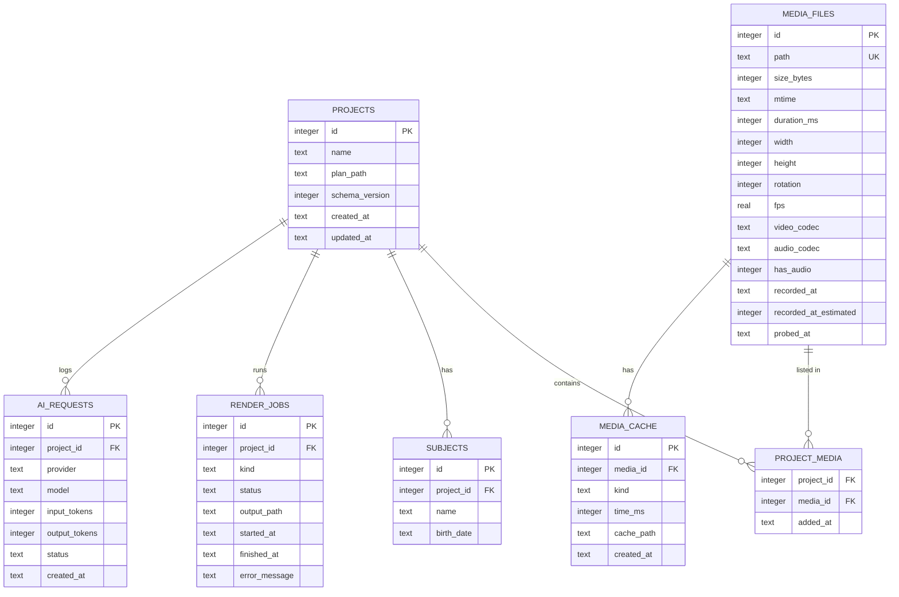

# Database schema

How promptcut stores data.

## Division of storage

| Data | Stored in | Why |
|---|---|---|
| Media metadata, thumbnail and proxy cache | SQLite | Stays fast as the library grows |
| Edit plans, project settings | JSON files | Human-readable and editable, and diffable in Git |
| Source video | Left in place | Only the path is stored; originals are never modified |

The SQLite file lives in the app support directory and cache files in the cache directory. Project JSON is saved wherever the user chooses.

## ERD

## Tables

### projects

The project registry, used for the recent-projects list. The actual edit content lives in the JSON file at `plan_path`.

- `plan_path` — path to the project JSON file
- `schema_version` — JSON format version, so older files stay readable

### media_files

Metadata for source video. `path` is unique, and a row with an unchanged `mtime` is reused instead of re-probing.

- `rotation` — rotation metadata, needed for portrait iPhone footage
- `recorded_at` — recording date
- `recorded_at_estimated` — whether the date fell back to file mtime
- `has_audio` — identifies silent clips, which need a generated audio track when joined

### media_cache

Locations of files derived by ffmpeg.

- `kind` — `poster` (single thumbnail), `strip` (timeline thumbnails), `proxy` (low-resolution preview)
- `time_ms` — timestamp of a `strip` thumbnail; null otherwise
- Cache files are safe to delete; they are regenerated on demand.

### project_media

Which media belong to a project. The same file can appear in several projects, hence a join table.

Clip order, in and out points and caption text are *not* stored here — they live in the edit plan JSON. Keeping them in one place avoids duplicate state.

### subjects

Subjects used for age captions: a pet, a child, anyone whose age should be derived from a birth date.

### render_jobs

Render history.

- `kind` — `preview` or `export`
- `status` — `running`, `done`, `failed`, `canceled`
- `error_message` — ffmpeg output on failure

### ai_requests

AI call history, feeding the usage readout and the per-operation call ceiling.

- `provider` — `gemini`, `claude`, and so on
- `status` — `ok`, `invalid_response`, `rate_limited`, `error`

## Indexes

- `media_files(path)` — unique
- `media_cache(media_id, kind)`
- `project_media(project_id)`
- `render_jobs(project_id, started_at)`
- `ai_requests(project_id, created_at)`

## Deletion rules

- Deleting a project also deletes its rows in `project_media`, `subjects`, `render_jobs` and `ai_requests`.
- `media_files` rows survive removal from a project, so re-adding the file skips probing.
- `media_cache` entries are treated as invalid when the source is gone or its `mtime` changed, and are regenerated.
- The program never deletes source video files.
